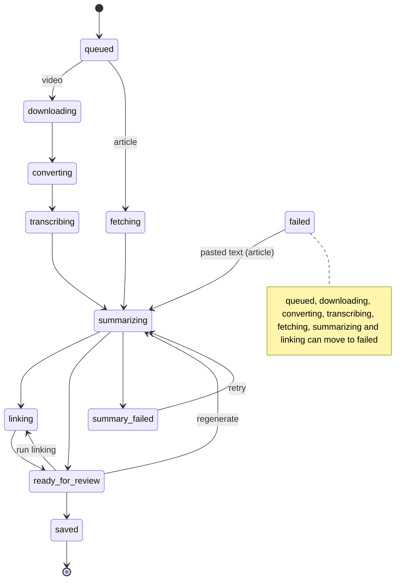
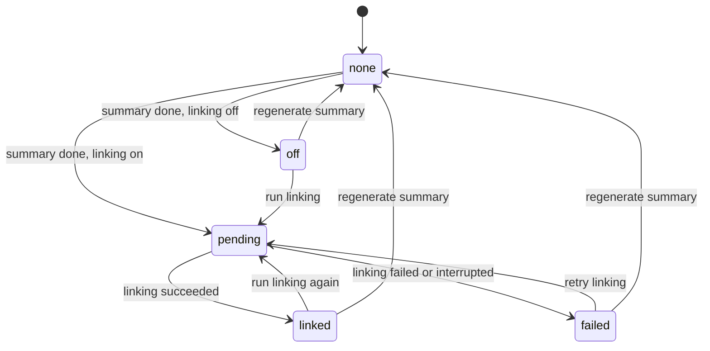

# 0048. One job lifecycle: a pure table of states and moves, enforced by `moveTo`

- Status: Accepted
- Date: 2026-10-21

## Context
By 0.7.0 a job can come from five places (video, article, feed item, newsletter, pasted text) and passes through up to eleven statuses, plus a separate link state. Every status change already goes through `moveTo()` in `jobs.service.ts`, and `nextStep` covers the acquisition steps, but the rest of the rules are spread out: each service function checks the current status by hand, `expires_at` is set at about ten call sites, the job repository hard-codes four status lists in SQL, and the two startup-recovery updates bypass `moveTo()`. A new status or source would mean finding all of these. The tutor and the idea validator will add more job-like flows on the same base.

## Decision
- `apps/server/src/jobs/lifecycle.ts` is a pure module holding, for every `JobStatus`, its properties (`runnable`, `active`, `expires`, `terminal`, `editable`, `onRestart`) and the list of allowed moves, each optionally limited to source types. The link state (`off | pending | linked | failed`) has its own small table in the same module.
- `moveTo()` refuses any move the table doesn't list (the existing conflict error, logged). A same-state move is allowed only in `editable` states. `moveTo()` sets or clears `expires_at` from the target state's `expires`; callers pass it only for the autosave reset.
- The repository's status lists (`findNextRunnableJob`, `listActiveJobs`, `findExpiredJobs`, the two recovery updates) are built from the properties.
- The lifecycle stays in the server. The web app uses only `JobStatus` from `packages/shared`.
- No state-machine library.
- The table reproduces 0.7.0 exactly. A characterization test, written first against the 0.7.0 services, pins every move and stays in the suite.

## The lifecycle
Final version, taken from the characterization test (`jobs/lifecycle.characterization.test.ts`), which pins 0.7.0. Three points differ from what the TRD first expected, and the test is the authority:

- `failJob` works from seven states only (`queued`, `downloading`, `converting`, `transcribing`, `fetching`, `summarizing`, `linking`). It is not available from `ready_for_review` or `summary_failed`.
- `editable` is `ready_for_review` only. `summary_failed` is not editable: editing the draft, accepting and rejecting suggestions give 409 there.
- `summary_failed → saved` does not exist; only `ready_for_review` is saved.

| State | runnable | active | expires | terminal | editable | onRestart |
| --- | --- | --- | --- | --- | --- | --- |
| queued | ✓ | ✓ | | | | — |
| fetching, downloading, converting, transcribing | | ✓ | | | | failed |
| summarizing | ✓ | ✓ | | | | — (picked up again) |
| linking | ✓ | ✓ | | | | ready_for_review (link failed) |
| ready_for_review | | ✓ | ✓ | | ✓ | — |
| summary_failed | | ✓ | ✓ | | | — |
| saved | | | | ✓ | | — |
| failed | | | | ✓ | | — |

Moves: video `queued → downloading → converting → transcribing → summarizing`; article `queued → fetching → summarizing`; `summarizing → linking | ready_for_review | summary_failed`; `linking → ready_for_review`; `summary_failed → summarizing` (retry); `ready_for_review → summarizing` (regenerate), `→ linking` (run linking), `→ saved`; `failed → summarizing` (article, pasted text); the seven states above `→ failed`. A same-state move is allowed only in `ready_for_review`.

The table lists which moves exist, not which function may make them: `summarizing → ready_for_review` is a legal move, yet `failLinking` must start from `linking`. A service function that makes one move therefore also names its start status (`assertFrom`), and `moveTo()` asks the table for the move itself.

The link state (`null`, `off`, `pending`, `linked`, `failed`) has its own table in `lifecycle.ts`:

## Consequences
- Adding a status or a source is one table edit plus tests; the SQL, the expiry and the recovery follow.
- A bug that writes an impossible status now fails loudly instead of leaving a stuck job.
- The move checks and their error messages move into one place; the messages are kept so the API doesn't change. Each function that makes one move still names its start status (`assertFrom`), since the table can't say which function may make a move.

## Alternatives considered
- **XState or another state-machine library:** more than a table of about 20 moves needs, and a new dependency.
- **Lifecycle in `packages/shared`:** would let the web app hide impossible actions, but the server already answers 409 and the web app doesn't need the moves today. Can be moved later.
- **Database CHECK constraints or triggers:** can't express per-source moves cleanly and would hide the rules from TypeScript.
